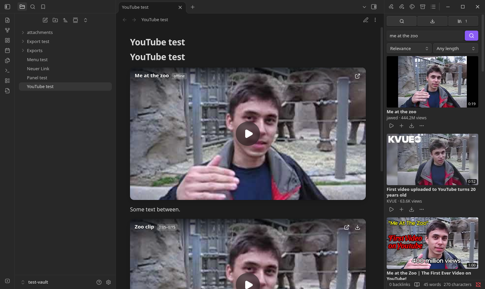

# YouTube Native for Obsidian

Starnote's YouTube features as an Obsidian plugin. YouTube links in notes become players that use
the direct streams it resolves (with the built-in engine, or your own [yt-dlp](https://github.com/yt-dlp/yt-dlp)), so YouTube's embedded
iframe is never loaded. Desktop only.

The plugin needs no ffmpeg. It never downloads, installs, or updates anything: yt-dlp is optional
and only used if you already have it installed.

<a href="https://www.paypal.com/donate/?hosted_button_id=H4SCC24R8KS4A"></a>



> **Not an official YouTube product.** This plugin is not affiliated with, endorsed by, or supported
> by YouTube, Google, or Obsidian. It uses an independent open-source YouTube client library (and
> optionally your own [yt-dlp](https://github.com/yt-dlp/yt-dlp)), and it may stop working whenever
> YouTube changes.
> You are responsible for how you use it; see the [disclaimer](#disclaimer).[^1]

[^1]: YouTube is a trademark of Google LLC. Obsidian is a trademark of Dynalist Inc. Their names are
    used only to describe what the plugin works with.

## Features

- **YouTube panel.** The icon at the bottom of the left toolbar (or **Open YouTube panel**) opens a sidebar panel modelled on
  Starnote's media hub, with three tabs:
  - **Search**: search YouTube (sort by relevance or newest, filter by length, **Load more**), or
    paste a video, playlist, or channel link to list it. Click a thumbnail to preview it in the panel's
    player; **Insert**, **Insert + save offline**, or **Save to library**. Results can be dragged into a
    note.
  - **Downloads**: the offline-save queue (two at a time) with progress, cancel, retry, and links to
    the file and the note. The ribbon icon shows a count while downloads run.
  - **Library**: every offline copy, to play, insert into a note, open on YouTube, or delete.
- **Note players.** A YouTube link on its own line, ``,
  becomes a borderless 16:9 player in Reading view and Live Preview: the thumbnail with the title,
  range, and actions overlaid, and a play button. It loads on click and plays the direct streams in
  the plugin's own player (separate audio is kept in sync): a seek bar with buffered progress, hover
  time, and the note's start/end range, volume, time, a speed and quality menu, picture-in-picture,
  and fullscreen with the same controls. Controls fade while playing; click toggles play,
  double-click toggles fullscreen. Keys (when the player has focus): Space/K play, ←/→ 5 s, J/L 10 s,
  ↑/↓ volume, M mute, F fullscreen, P picture-in-picture, 0–9 jump, `<`/`>` speed, `,`/`.` frame step.
  Volume is remembered. Changing quality keeps the position and fullscreen. If no stream plays, the
  player offers **Open on YouTube**. Put the caret on the line, or use the **Edit Markdown** button,
  to edit the source.
- **Real titles.** Captions that are empty or still say `video` / `YouTube video` are replaced with
  the video's title from YouTube when the player is shown (setting), or for a whole note with
  **Fill in YouTube titles in this note**.
- **Insert YouTube video.** Accepts watch, share, Shorts, live, and embed links. Leave the title
  blank to use the real one.
- **Offline copies.** Pick a quality with its size (`≈` marks estimates) and download with
  progress and cancellation. As in Starnote, video and audio are kept as separate files in your
  attachment folder, so no ffmpeg is needed. The note's embed becomes a block that plays them
  together without a connection:

  ````markdown
  ```youtube-offline
  title: Me at the zoo
  video: attachments/Me at the zoo.f133.mp4
  audio: attachments/Me at the zoo.f140.m4a
  source: https://www.youtube.com/watch?v=jNQXAC9IVRw
  ```
  ````

## Built-in stream engine

The plugin ships its own YouTube client (a bundled JavaScript library, [youtubei.js](https://github.com/LuanRT/YouTube.js)), so it works out of the box: no yt-dlp, no ffmpeg, nothing to install. It looks up videos, playlists, channels and search results, resolves direct streams for playback, and downloads offline copies. Requests go straight from your computer to YouTube; the **Proxy** setting applies to them too.

Pick the engine under **Stream engine** in settings:

- **Automatic** (default): the built-in engine, with your own yt-dlp as a fallback if you have one installed.
- **Built-in only**
- **yt-dlp only**

Limitations: YouTube changes often, and this engine is much smaller than yt-dlp, so some videos (age-restricted, private, live, or very long ones without a usable high-quality stream) may fail or fall back to a lower quality such as 360p. Updates to the plugin are how the engine gets fixed.

## yt-dlp (optional)

yt-dlp is strictly optional and user-installed; the plugin never downloads, installs, or updates it.
If you already have it, either put its path in settings (**yt-dlp path (optional)**) or leave the
field blank and the plugin uses `yt-dlp` from your `PATH`. The settings page shows which yt-dlp was
found and its version. Keep it up to date yourself, as you would any other program.

## Install

### Obsidian directory

YouTube Native is listed in the official Obsidian plugin directory: [community.obsidian.md/plugins/youtube-native](https://community.obsidian.md/plugins/youtube-native). Install it from there, or from Settings → Community plugins → Browse once it appears for you.

### BRAT (installs and keeps it updated)

1. Install **BRAT** from Settings → Community plugins → Browse, and enable it.
2. Run the command **BRAT: Add a beta plugin for testing** and enter `encomjp/obsidian-youtube`, or click
   [this link](obsidian://brat?plugin=encomjp/obsidian-youtube) with BRAT installed.
3. Enable the plugin under Settings → Community plugins. BRAT then updates it with every release.

### Manual

Copy `main.js`, `manifest.json` and `styles.css` from the latest release into your vault's plugin folder, so that
`<vault>/.obsidian/plugins/youtube-native/main.js` exists, then enable **YouTube Native** under
Settings → Community plugins. To build it yourself:

```bash
npm install
npm run build
mkdir -p "<vault>/.obsidian/plugins/youtube-native"
cp main.js manifest.json styles.css "<vault>/.obsidian/plugins/youtube-native/"
```

## Development

```bash
npm run dev     # rebuild main.js on change
npm run check   # type-check
npm test        # unit tests (node --test)
```

Tested in Obsidian 1.14.4 (Flatpak, Linux): Reading view and Live Preview cards, playback with
separate audio, start/end ranges, title filling, the panel (search, preview, insert, queue, library),
and offline save and playback. Embeds pasted as nested links, `)`,
are recognised too.

### Windows

When you use your own yt-dlp, it runs with UTF-8 output so non-ASCII titles and user
folders survive the ANSI code page; cancelling stops the whole process tree (`taskkill /T`), because
`yt-dlp.exe` runs Python in a child process; temporary folders are removed with retries while Windows
still holds a file open; and saved file names avoid reserved names (`CON`, `NUL`, …), trailing dots,
and over-long paths.

### Work networks (HTTPS inspection, proxies)

Firewalls that inspect HTTPS (DPI) and antivirus "web shields" re-sign traffic with their own root
certificate, which IT installs into the operating system. yt-dlp normally trusts only its own bundled
list, so it would fail with `CERTIFICATE_VERIFY_FAILED`. The plugin runs yt-dlp with
`--compat-options no-certifi` so it uses the system certificate store (always on Windows; on Linux and
macOS as a retry, pointing it at the system bundle). Certificate checking is never disabled. If a
proxy is required for programs, set it under **Proxy** in the plugin settings.

`src/youtube.ts` holds the link, timestamp, caption, and insertion rules ported from Starnote;
`src/formats.ts` the yt-dlp output parsing; both are tested without Obsidian.
`src/ytdlp.ts` runs the executable, `src/player.ts` draws the card, `src/livePreview.ts` and the
post-processor in `src/main.ts` place it in notes.

## Differences from Starnote

- Playback uses Obsidian's built-in Chromium media stack instead of VLC/mpv, so there is no
  YoutubeExplode or VLC fallback; the browser handoff remains the last resort.
- An offline copy is described by a `youtube-offline` block in the note rather than a sidecar file.
  Renaming the saved files does not update the block.
- YouTube's [player policies](https://developers.google.com/youtube/terms/required-minimum-functionality)
  still apply to use of its streams.

## Disclosures

- **Network use.** The plugin contacts these services:
  - **YouTube** (`youtube.com`, `googlevideo.com`, `i.ytimg.com`): video titles, thumbnails, and, through the built-in engine (or your own yt-dlp), the video information and streams for the videos you play or save.
  - Nothing else is contacted; the plugin never downloads or runs code from the internet.
- **Files outside your vault.** The built-in engine uses temporary download folders, which are removed afterwards. The plugin only runs the yt-dlp you installed yourself (if you choose to use it) as a program on your computer, and uses temporary download folders, which are removed afterwards. Offline copies are saved inside your vault, in the attachment folder.
- **No** account, payment, ads or telemetry.

## Support

If this saves you time, you can [buy me a coffee](https://www.paypal.com/donate/?hosted_button_id=H4SCC24R8KS4A).

## Disclaimer

This plugin is an independent project. It is **not affiliated with, endorsed by, sponsored by, or
supported by YouTube, Google LLC, or Dynalist Inc. (Obsidian)**, and it is not affiliated with the
yt-dlp or youtube-dl projects. All trademarks belong to their respective owners.

- **How it works.** The plugin is a user interface that, with the built-in engine or your own
  yt-dlp installation, looks up and fetches publicly
  available streams. It does not include, bypass, or circumvent DRM, paywalls, age or region
  restrictions, sign-ins, or any other technical protection measure.
- **Your responsibility.** You alone are responsible for how you use the plugin and the content you
  play or save with it. Use it only in compliance with
  [YouTube's Terms of Service](https://www.youtube.com/t/terms), the rights of content owners, and
  the copyright and other laws that apply to you. Save offline copies only of content you own, that is
  licensed for download, or that you otherwise have the right to copy, and only for your personal use.
  Your employer's or network's IT policies may also apply.
- **No warranty.** The software is provided "as is", without warranty of any kind, express or implied,
  including but not limited to merchantability, fitness for a particular purpose, and
  non-infringement. The plugin may stop working at any time, for example when YouTube changes its
  service.
- **No liability.** To the maximum extent permitted by law, the authors and contributors are not
  liable for any claim, damages, or other liability arising from the software or its use, including
  data loss, account suspension or termination, network or policy violations, or legal claims by
  third parties. See [LICENSE](LICENSE) (MIT).
- **Not legal advice.** Nothing in this project is legal advice. If you are unsure whether a use is
  permitted, ask a qualified lawyer or the content owner.


---

Made by [Adrian Kozlowski](https://adrian-kozlowski.de), IT specialist for systems integration and IT security in Mannheim. More projects on the [portfolio](https://adrian-kozlowski.de), and free browser games at [games.adrian-kozlowski.com](https://games.adrian-kozlowski.com).
